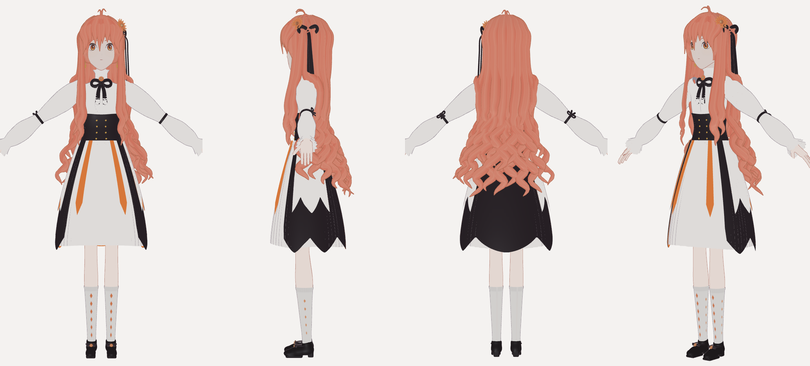
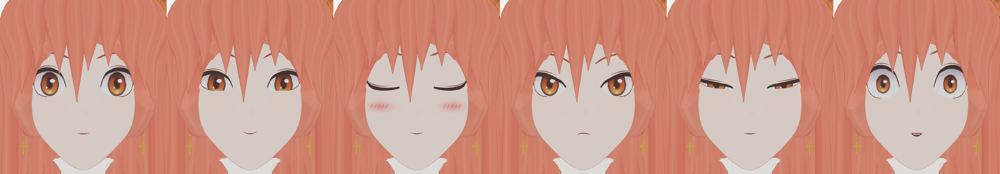
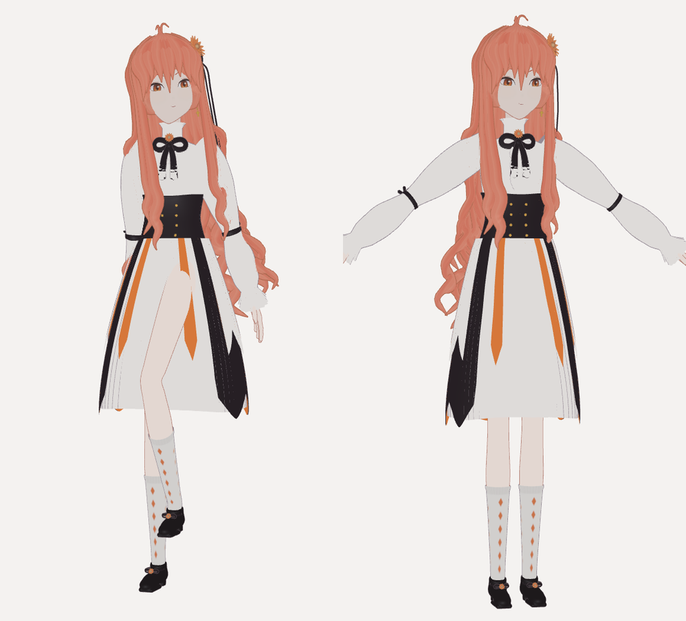

# 橙花（Touka）— PMX 2.0 模型

根据两张参考图（素体三视图 + 角色设定三视图）用程序生成的 MMD 模型：橙红色长卷发、左侧橙色花饰和黑色发带、
白色高领褶边衬衫、黑色束腰（金纽扣与金链）、黑色领结配橙花胸针、泡泡袖（肘部黑色蝴蝶结、荷叶边袖口）、
多层裙（白色百褶衬裙 + 黑色手帕裙摆/橙色里衬 + 白色侧垂片 + 橙色飘带）、橙色菱格白袜、黑色玛丽珍鞋、十字耳坠。





> 预览图由 three.js 的 MMDLoader 读取本 PMX 文件后渲染，光照与 MMD 不完全相同（MMD 中颜色会更亮）。

## 文件

| 路径 | 内容 |
|---|---|
| `model/Touka/Touka.pmx` | 模型本体（PMX 2.0，UTF-16LE） |
| `model/Touka/tex/` | 贴图、Toon、Sphere（全部 PNG，PMX 内以相对路径 `tex\xxx.png` 引用） |
| `generator/` | 生成器源码（Python + NumPy + Pillow） |
| `tools/validate_pmx.py` | PMX 结构校验 |
| `tools/preview/` | three.js 预览渲染（Playwright） |

使用时把 `model/Touka` 整个文件夹拷贝到 MMD / PMXEditor 中打开 `Touka.pmx` 即可。

## 规格

| 项目 | 数值 |
|---|---|
| 格式 | PMX 2.0（顶点索引 4 字节） |
| 身高 | 约 19.6 单位（≈155 cm，1 单位 ≈ 7.9 cm），约 6.5 头身 |
| 顶点 / 面 | 108,318 / 201,456 |
| 材质 / 贴图 | 24 / 18 |
| 骨骼 | 195（标准+准标准 94，头发 45，裙子 48，发带 8） |
| 表情变形 | 32（顶点 25、材质 2、组合 5） |
| 刚体 / 关节 | 114 / 149 |
| 初始姿势 | A 姿势，手臂向下 37° |

## 骨骼（MMD 标准 / 准标准骨骼名）

- 主干：`全ての親` `センター` `グルーブ` `腰` `上半身` `上半身2` `首` `頭` `両目` `左目` `右目` `下半身`
- 手臂（左右相同）：`左肩P` `左肩` `左肩C` `左腕` `左腕捩`（含 `左腕捩1~3`）`左ひじ` `左手捩`（含 `左手捩1~3`）`左手首`
- 手指：`左親指０~２` `左人指１~３` `左中指１~３` `左薬指１~３` `左小指１~３`
- 腿：`腰キャンセル左` `左足` `左ひざ` `左足首` `左つま先`，IK：`左足IK親` `左足ＩＫ` `左つま先ＩＫ`，
  D 骨：`左足D` `左ひざD` `左足首D` `左足先EX`（变形阶层 1，蒙皮权重在 D 骨上）
- 设置要点：
  - 足ＩＫ：循环 40、单位角 2 rad，膝盖限制 X ∈ [-180°, -0.5°]；つま先ＩＫ：循环 3、单位角 4 rad
  - `腕捩` / `手捩` 设有固定轴，`腕捩1~3`、`手捩1~3` 分别以 0.25/0.5/0.75 付与旋转，用于平滑扭转
  - `左目`/`右目` 以比例 1.0 付与 `両目` 的旋转；`肩C` 以 -1 付与 `肩P`；`腰キャンセル` 以 -1 付与 `腰`
  - 手臂与手指设置了局部轴（右侧 X 轴指向父骨骼，方便左右对称操作）
- 所有骨骼名与表情名在 Shift-JIS 下不超过 15 字节，可直接配合 VMD 动作使用。
- 物理骨骼：`後髪1_1`~`後髪7_5`（后发 7 链×5）、`左横髪1~5`/`右横髪1~5`（前侧发）、`スカート00_1`~`スカート15_3`（裙 16 链×3）、`リボン1_1`~`リボン2_4`（发带飘带）

## 发型结构

按发型分层参考图拆成以下几层（全部由 `generator/hair.py` 生成）：

| 层 | 内容 | 权重 / 物理 |
|---|---|---|
| 发帽 | 贴合头型的底层，贴图从发旋向四周放射成束 | `頭` |
| 刘海 | 10 束，中间一缕垂到两眼之间，两侧渐长修饰脸型 | `頭` |
| 前侧发 | 左右各 2 束，从太阳穴垂到胸前，胸口以下打大卷、发尾回钩 | `左横髪1~5` / `右横髪1~5` |
| 后发·上层 | 8 束，到背中部，发尾微卷 | `後髪*` |
| 后发·中层 | 10 束，到腰，腰以上开始 S 形卷 | `後髪*` |
| 后发·下层 | 12 束，到大腿，螺旋大卷，左右旋向交替 | `後髪*` |
| 呆毛 | 头顶 2 根细弧线 | `頭` |
| 饰品 | 左侧橙色大花 + 黑色蝴蝶结，两条飘带垂到肩下 | `頭` / `リボン*` |

发根在头顶藏在发帽下面、往下逐渐露出，避免头顶出现台阶；每束头发靠近身体或头部时会自动外推，不会穿进脸、肩、手臂和裙子。

## 表情变形

| 面板 | 变形 |
|---|---|
| 眉 | 真面目、困る、にこり、怒り、上、下 |
| 目 | まばたき、笑い、なごみ、ウィンク、ウィンク２、ウィンク右、ｳｨﾝｸ２右、じと目、怒り目、びっくり、瞳小、ハイライト消し |
| 口 | あ、い、う、え、お、口角上げ、口角下げ、∧ |
| 其他 | 照れ（脸红，材质变形）、以及对应参考图的组合预设：微笑み（微笑）、恥ずかしい（害羞）、怒る（生气）、眠い（困倦）、驚き（惊讶） |

眼睛采用“眼睑遮罩”结构：肤色的上下眼睑贴片盖在眼白/瞳孔之上，眨眼时遮罩闭合，因此瞳孔不会被压扁，
`両目` 转动时瞳孔也会被眼睑自然裁切。

## 物理

- 碰撞组：1 身体（静态，跟随骨骼）、2 头部、3 头发、4 裙子、5 饰品。头发/裙子/饰品只与身体碰撞，彼此不碰撞。
- 动态刚体全部使用“物理+骨骼位置对齐”（模式 2）。裙子在纵向关节之外还有横向关节保持裙撑形状。
- 刚体旋转只使用 Y、Z 两个欧拉角（X 恒为 0），因此在 MMD（YXZ 顺序）和其他实现（XYZ 顺序）中结果一致。
- 已在 three.js + ammo.js 中以上半身/下半身左右扭动跑 4 秒模拟：无数值发散，裙子保持 A 字形，头发自然下垂。

## 重新生成

```bash
pip install -r requirements.txt
python3 -m generator.build                     # 输出到 model/Touka/
python3 tools/validate_pmx.py model/Touka/Touka.pmx
```

预览（可选，需要 Node.js、`npm install three@0.160.0` 与 Playwright）：先在仓库根目录之上起一个静态服务器，
再运行 `node tools/preview/render.js <服务器URL>/<仓库路径> <pmx URL路径> <three 包 URL路径> <输出目录> tools/preview/views_docs.json`。

## 已知限制与使用建议

- 这是程序化建模而非手工雕刻：头部/手/鞋由 SDF 等值面生成，衣服与头发由放样曲面生成，细节（布料褶皱、发丝层次）比手工模型简单。
- three.js 不支持材质变形，所以 `照れ`、`ハイライト消し` 在预览中是模拟的；在 MMD 中照常工作（`頬` 材质默认透明度 0，由材质变形加到 1）。
- 头发与裙子之间没有碰撞；大幅度抬腿、劈叉、手臂穿过长发时可能有穿模，可在 PMXEditor 中按需调整刚体与关节参数。
- 眉毛被刘海部分遮住（与参考图一致），`怒る` 预设因此同时使用了 `怒り目` 来表现生气。
- 模型名“橙花 / Touka”为生成时自拟，可在 PMXEditor 的模型信息中修改。
- 参考图中的角色设计归其原作者所有；本仓库只包含根据参考图生成的模型数据。
